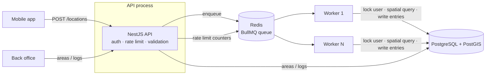

# Location Tracking Service

A microservice that receives user locations (≈ every 5 seconds per active user), detects when a
user **enters** a predefined polygon area and records that entry.

Built with **NestJS · TypeScript · PostgreSQL + PostGIS · TypeORM · BullMQ (Redis) · OpenTelemetry**.

- [Quick start](#quick-start)
- [API](#api)
- [Architecture](#architecture)
- [How entry detection works](#how-entry-detection-works)
- [Assumptions & decisions](#assumptions--decisions)
- [Technology choices](#technology-choices)
- [Configuration](#configuration)
- [Scalability](#scalability)
- [Observability](#observability)
- [Security](#security)
- [Testing](#testing)
- [Out of scope / next steps](#out-of-scope--next-steps)
- [Project structure](#project-structure)

---

## Quick start

Requirements: Docker with Compose v2.

```bash
docker compose up --build
```

This starts PostgreSQL/PostGIS, Redis, runs the migrations, loads demo areas, then starts
**1 API** and **2 worker** instances.

| What | Where |
|---|---|
| API | http://localhost:3000 |
| Swagger UI (try every endpoint) | http://localhost:3000/docs |
| Health | http://localhost:3000/health/ready |
| Metrics (Prometheus) | http://localhost:3000/metrics |

Demo API keys (set in `docker-compose.yml`, **for local use only**):

| Key | Value | Allowed |
|---|---|---|
| ingest (mobile app) | `dev-ingest-key-change-me` | `POST /locations` |
| admin (back office) | `dev-admin-key-change-me` | everything |

### Try it

Demo areas are simplified rectangles in Istanbul, picked to show the interesting cases:
`Moda` lies inside `Kadikoy`, `Acibadem` straddles the `Kadikoy`/`Uskudar` border and
`Kadikoy`/`Uskudar` share a border.

```bash
# A user walks into Moda (which is inside Kadikoy) → two entries: Kadikoy and Moda
curl -X POST localhost:3000/locations \
  -H 'x-api-key: dev-ingest-key-change-me' -H 'content-type: application/json' \
  -d "{\"userId\":\"user-42\",\"latitude\":40.982,\"longitude\":29.027,\"timestamp\":\"$(date -u +%Y-%m-%dT%H:%M:%SZ)\"}"

# Read the recorded entries
curl 'localhost:3000/logs?userId=user-42' -H 'x-api-key: dev-admin-key-change-me'
```

### Run locally without Docker

Requires Node.js 22, PostgreSQL 16 with PostGIS 3 and Redis 7.

```bash
npm ci
cp .env.example .env          # adjust DATABASE_URL / REDIS_URL
npm run build
npm run migration:run && npm run seed
npm run start:api             # terminal 1
npm run start:worker          # terminal 2
```

---

## API

All endpoints except health and metrics require the `x-api-key` header.
Errors always have the same shape, with a stable machine readable `error` code:

```json
{ "statusCode": 422, "error": "TIMESTAMP_IN_FUTURE", "message": "...", "serverTime": "2026-11-17T14:00:05.000Z", "timestamp": "...", "path": "/locations" }
```

### `POST /locations` (ingest key)

```json
{ "userId": "user-42", "latitude": 40.982, "longitude": 29.027, "timestamp": "2026-11-17T14:00:05Z" }
```

| Status | When |
|---|---|
| **202** Accepted | Valid, queued for processing. Resulting entries show up in `GET /logs` shortly after. |
| 400 `VALIDATION_ERROR` | Wrong shape: latitude ∉ [-90, 90], longitude ∉ [-180, 180], timestamp without timezone, unknown fields… |
| 422 `TIMESTAMP_IN_FUTURE` | More than `MAX_FUTURE_SKEW_SECONDS` ahead of server time. Includes `serverTime`. |
| 422 `TIMESTAMP_TOO_OLD` | Older than `MAX_LOCATION_AGE_SECONDS`. Includes `serverTime`. |
| 422 `INVALID_COORDINATES` | Exactly `(0, 0)` ("Null Island", the typical value of a failed GPS fix). |
| 429 `RATE_LIMITED` | More than `RATE_LIMIT_LOCATIONS_PER_MINUTE` for this `userId`. `Retry-After` header is set. |

`userId`: 1–64 characters, `[A-Za-z0-9._-]`. `timestamp`: ISO 8601 with `Z` or `±hh:mm`.

### `POST /areas` (admin key)

```json
{
  "name": "Kadikoy",
  "geometry": {
    "type": "Polygon",
    "coordinates": [[[29.02, 40.96], [29.10, 40.96], [29.10, 41.00], [29.02, 41.00], [29.02, 40.96]]]
  }
}
```

> ⚠️ `geometry` is a **GeoJSON Polygon** (RFC 7946): positions are **`[longitude, latitude]`**,
> not `[lat, lng]`. Rings must be closed (first position = last position). Holes are allowed as
> additional rings.

| Status | When |
|---|---|
| **201** | Created. Returns `id`, `name`, `geometry`, `createdAt`. |
| 400 `INVALID_POLYGON` | Not a Polygon, unclosed ring, < 4 positions, coordinates out of range, more than `POLYGON_MAX_VERTICES` positions, or geometrically invalid (e.g. self-intersecting "bow-tie", checked by PostGIS). `details` lists every problem. |
| 409 `AREA_NAME_CONFLICT` | Name already used (case-insensitive). |

### `GET /areas` (admin key)

`?page=1&limit=20` (max 100), newest first. Returns `{ items, meta: { page, limit, total, totalPages } }`.

### `GET /logs` (admin key)

| Query | Meaning |
|---|---|
| `userId`, `areaId` | Filters |
| `from` (inclusive), `to` (exclusive) | ISO 8601 time range on the entry time |
| `limit` | 1–200, default 50 |
| `cursor` | `nextCursor` of the previous page |

Returns `{ items: [{ id, userId, areaId, areaName, enteredAt, latitude, longitude }], nextCursor }`,
newest first. `nextCursor: null` means this was the last page.

### Health & metrics (public)

- `GET /health/live`: the process is up.
- `GET /health/ready`: PostgreSQL and Redis are reachable (`503` otherwise).
- `GET /metrics`: Prometheus metrics. Workers expose the same on port `3001`.

---

## Architecture



The **API and the worker are separate processes from the same codebase/image** and scale
independently:

1. **API** (`src/main.ts`) validates the location synchronously (so the client gets precise errors
   immediately), pushes it to a BullMQ queue and answers **202** in a few milliseconds.
2. **Worker** (`src/worker.ts`) consumes the queue and runs entry detection in a single database
   transaction. Failed jobs are retried with exponential backoff, so a database hiccup does not
   lose locations.

Traffic spikes (e.g. everyone starting work at 09:00) only make the queue longer for a moment
instead of overloading the database and causing timeouts and client retries.

### Data model

| Table | Purpose |
|---|---|
| `areas` | `geometry(Polygon, 4326)` + GiST index on `geometry` and on `geometry::geography`. Unique index on `lower(name)`. A `CHECK (ST_IsValid(geometry))` constraint protects data written outside the API too. |
| `area_entries` | The logs. `UNIQUE (user_id, area_id, entered_at)` + FK to `areas` (`ON DELETE RESTRICT`). Indexes match the pagination order for every filter. |
| `user_area_states` | One row per user: areas the user is currently in, and the device timestamp of the last processed location. |

The schema is owned by migrations (`synchronize` is never used).

---

## How entry detection works

For every location the worker runs **one transaction**:

```text
BEGIN
  1. Lock the user's state row         SELECT ... FOR UPDATE
  2. Stale? (timestamp <= last processed) → stop
  3. Spatial query: areas the point is inside (ST_Covers) or within EXIT_BUFFER_METERS of (ST_DWithin)
  4. Decide (pure function, src/tracking/entry-detection.ts):
       previous = state, or ∅ if the last location is older than STATE_TTL
       entered  = inside_now − previous
       next     = inside_now ∪ (previous ∩ within_exit_buffer)
  5. INSERT entries ... ON CONFLICT DO NOTHING
  6. UPDATE the state row
COMMIT
```

The decision logic has no I/O, so every rule below is covered by unit tests.

---

## Assumptions & decisions

The case leaves several things open. These are the decisions taken, and why.

### 1. An entry is a transition from outside to inside
A user sending a location every 5 seconds while staying in an area produces **one** entry,
not one per location. Leaving and coming back produces a new entry. Exits are not recorded
(the case does not ask for them).

### 2. The first location of a user counts as an entry
If the user is already inside an area when we see them for the first time (e.g. opens the app
inside the depot), it is recorded as an entry. Otherwise a user who spends the whole day in one
area would never show up in the logs.

### 3. Long silence starts a new session (`STATE_TTL_SECONDS`, default 30 min, configurable)
If no location was processed for a user for longer than `STATE_TTL_SECONDS`, the previous state
is forgotten and the user is treated as seen for the first time. Example: the user was in the
depot at 18:00, the app was closed overnight, and at 08:00 the user is in the depot again →
**new entry**. Short gaps (elevator, tunnel) keep the state and create no duplicate entry.
The default fits "active session" apps. Tune it to the business: longer for field teams, shorter
where short visits matter.

### 4. Out-of-order locations never change state
Mobile networks deliver packets out of order, and with parallel workers jobs can also finish out
of order. The worker keeps the **device timestamp** of the last processed location per user. A
location that is **older than or equal to** it is ignored for detection. Without this rule, a
late packet could create a fake re-entry (`:00 in → :10 out → :05 in (late)`).
*Trade-off:* a very short visit whose only "inside" location arrives late is not recorded.

### 5. Duplicates are harmless (idempotency)
Clients retry when a response is lost, so the same location can arrive several times, even at
the same moment on different workers. Two layers make processing idempotent:
- **Row lock** (`SELECT ... FOR UPDATE`) on the user's state: the same user's locations are
  processed one at a time. Different users never wait for each other.
- **Unique constraint** `(user_id, area_id, entered_at)` + `ON CONFLICT DO NOTHING`: even if the
  application logic were wrong, the database refuses duplicate entries.

A check in application code alone ("was it logged already?") would be racy. As a bonus, the queue
job id is derived from `(userId, timestamp)`, so retries are often deduplicated before reaching
a worker.

### 6. Areas are independent and may overlap
No hierarchy is assumed between areas. Real areas nest (Moda in Kadikoy) and also partially
overlap (Acibadem crosses the Kadikoy/Uskudar border), so a parent/child model would give wrong
answers. Every area is checked geometrically on its own. Being inside several areas creates one
entry per area. Walking from Kadikoy into Moda creates only the Moda entry (already in Kadikoy).

### 7. The boundary belongs to the area
`ST_Covers` (boundary included) is used instead of `ST_Contains` (boundary excluded). A point on
the shared border of two adjacent areas is in both, instead of being lost between them.

### 8. GPS jitter is absorbed with hysteresis (`EXIT_BUFFER_METERS`, default 10 m, configurable)
GPS positions jitter by several meters. A user standing still at the border would flip in/out and
create many fake entries. Rule: **entering is immediate, leaving requires moving more than
`EXIT_BUFFER_METERS` away from the polygon.** A user who was inside and is now outside but still
within the buffer is kept inside.
The buffer is applied **outside only**. A buffer on both sides would delay entries, and in areas
narrower than twice the buffer it would prevent entries completely. `0` disables the feature.

### 9. Areas cannot be deleted or edited through the API
Not required by the case. If it were needed:
- **Soft delete** (`is_active = false`) keeps historical entries meaningful. Inactive areas are
  excluded from detection.
- If the history is not needed either, the area and its entries can be deleted together
  (cascade) by an admin operation.
- Changing a geometry would make old entries misleading. Prefer creating a new area and
  deactivating the old one.

The `ON DELETE RESTRICT` foreign key prevents deleting an area that has entries by accident.
Areas created later work naturally: a user already inside a new area gets an entry with their
next location (same rule as #2).

### 10. Invalid input is rejected with precise, actionable errors
Besides shape validation (ranges, ISO 8601 **with timezone**, unknown fields rejected):
- **Future timestamps** (> `MAX_FUTURE_SKEW_SECONDS`, default 5 min) are rejected. Accepting one
  would make it the user's "last processed" time and silently discard all of that user's
  following (correct) locations.
- **Very old timestamps** (> `MAX_LOCATION_AGE_SECONDS`, default 24 h) are rejected.
- Both return `serverTime` and a distinct error code. The backend cannot show anything to the user,
  but the mobile app can, e.g. "your device clock seems wrong". Only the app knows whether an
  old location was buffered offline (normal) or comes from a wrong clock (user should be warned),
  so the decision to warn belongs to the app.
- `(0, 0)` is rejected as a failed GPS fix.
- Alternative considered: replacing a wrong device timestamp with the server time. Rejected
  because it mixes two clocks and breaks the ordering rule (#4).

### 11. The user state lives in PostgreSQL, next to the entries
The state ("which areas is the user in") is shared by all workers, so it cannot live in process
memory. It is stored in PostgreSQL rather than Redis so that **writing entries and updating the
state happen in one ACID transaction**: either both happen or neither, with no inconsistency after
a crash. Redis would be faster, but keeping two systems consistent would require extra machinery.
See [Scalability](#scalability) for when that would change.

### 12. Location history is not stored
Only entries are required. Storing every location would mean ~170 million rows/day at 10k active
users, and location data is **personal data** (KVKK / GDPR, data minimization principle). The last
known location is kept in the user state, and the entry coordinates are stored with each entry.

### 13. Entry logs have an optional retention period (`LOG_RETENTION_DAYS`, default disabled)
A scheduled job (BullMQ job scheduler) deletes entries older than the configured period in small
batches, so the table is never locked for long. It is **disabled by default** because the
retention period is a business/legal decision, not the developer's.

### 14. Pagination: page numbers for areas, cursor for logs
Areas are few and change rarely, so `page/limit` is the most convenient. Logs grow without bound:
keyset pagination on `(entered_at, id)` costs the same on the first and the millionth page, and
rows inserted while paging never shift or duplicate results.

### 15. "Entry Time telemetry OTEL"
The log field list in the case contains the text "Entry Time telemetry OTEL". I interpreted it as
the entry time **plus** an expectation that the service is observable with **OpenTelemetry**. Both
are implemented (see [Observability](#observability)).

---

## Technology choices

| Choice | Why |
|---|---|
| **PostGIS** | Point-in-polygon at scale needs a spatial index. With a GiST index the lookup stays in the millisecond range with tens of thousands of areas (checked with `EXPLAIN ANALYZE` on 20 000 areas: both spatial indexes are used, ~4 ms). It also validates geometry (`ST_IsValid`) and computes metric distances on the sphere (`geography`). |
| **TypeORM** (over Prisma) | Prisma does not support PostGIS geometry types (they become `Unsupported`) and needs raw SQL for `SELECT ... FOR UPDATE`. TypeORM supports both and has an official NestJS integration. Spatial and locking queries are written as parameterized SQL on purpose, because they are the core of the service. |
| **BullMQ + Redis** | Decouples ingestion from processing, absorbs spikes, retries failures, and allows the API and the workers to scale independently. It is a well-known queue with first-class NestJS support. Redis also stores the shared rate limit counters. Kafka was considered and rejected: it is a lot of operational weight for this scale (see next steps). |
| **OpenTelemetry** | Vendor neutral traces and metrics. The same code exports to Jaeger, Grafana, Datadog… |
| **pino** (nestjs-pino) | Fast structured JSON logs with request ids. Trace ids are injected automatically. |
| **Joi** | The process refuses to start on missing or malformed configuration. |

---

## Configuration

All configuration comes from environment variables, validated at startup (`src/config/env.validation.ts`).
See `.env.example`.

| Variable | Default | Description |
|---|---|---|
| `DATABASE_URL` | – (required) | PostgreSQL connection string |
| `DATABASE_POOL_SIZE` | `20` | Connection pool size per process |
| `REDIS_URL` | – (required) | Redis connection string |
| `API_KEY_ADMIN` / `API_KEY_INGEST` | – (required) | Role based API keys (min. 16 chars) |
| `PORT` / `WORKER_PORT` | `3000` / `3001` | HTTP ports of API / worker (health + metrics) |
| `STATE_TTL_SECONDS` | `1800` (30 min) | Silence after which a user's state is forgotten (#3) |
| `EXIT_BUFFER_METERS` | `10` | Distance to move away from an area before leaving it (#8). `0` = off |
| `MAX_FUTURE_SKEW_SECONDS` | `300` (5 min) | Tolerated device clock skew (#10) |
| `MAX_LOCATION_AGE_SECONDS` | `86400` (24 h) | Oldest accepted location (#10) |
| `POLYGON_MAX_VERTICES` | `1000` | Max positions per polygon (protects against huge payloads) |
| `RATE_LIMIT_LOCATIONS_PER_MINUTE` | `60` | Per `userId`. A normal client sends ~12/min, the rest is headroom for offline catch-up |
| `RATE_LIMIT_ADMIN_PER_MINUTE` | `600` | Per API key, for area and log endpoints |
| `WORKER_CONCURRENCY` | `20` | Jobs processed in parallel per worker process |
| `LOG_RETENTION_DAYS` | `0` (disabled) | Delete entries older than this (#13) |
| `RETENTION_BATCH_SIZE` | `5000` | Rows deleted per batch |
| `RETENTION_CRON` | `0 3 * * *` | When the retention job runs |
| `LOG_LEVEL` | `info` | pino log level |
| `OTEL_SERVICE_NAME` | `location-tracking-service` | Service name prefix in traces |
| `OTEL_EXPORTER_OTLP_ENDPOINT` | empty (traces off) | e.g. `http://jaeger:4318` |

---

## Scalability

| Concern | How it is handled |
|---|---|
| Ingestion spikes | API only validates and enqueues → constant, low latency. The queue absorbs bursts. |
| Processing throughput | Add workers (`docker compose up --scale worker=4`) or raise `WORKER_CONCURRENCY`. Watch `location_queue_jobs{state="waiting"}`. |
| Many areas | GiST indexes on `geometry` and `geometry::geography`. Lookup cost does not grow with the number of areas. |
| Multiple instances | No in-memory state. User state, locks and rate limit counters are shared (PostgreSQL / Redis). |
| Same user processed in parallel | Serialized by a row lock. Correctness does not depend on job ordering. |
| Growing logs | Keyset pagination, filter-specific indexes, optional retention. |
| Redis restart | AOF persistence is enabled in compose, so queued locations survive. |

Back-of-the-envelope: 10 000 active users × 1 location / 5 s = **2 000 locations/s**. Each location
costs one short transaction with index-assisted queries. Beyond that, see next steps.

---

## Observability

| Signal | Implementation |
|---|---|
| **Logs** | Structured JSON (pino), request id per request (`x-request-id`), trace id on every log line, API keys redacted. Health and metrics calls are not logged. |
| **Health** | `/health/live` (restart me) vs. `/health/ready` (stop sending me traffic), on API and workers. Used by the compose healthchecks, and ready for Kubernetes probes. |
| **Metrics** | `/metrics` (Prometheus): `locations_received_total{result,reason}`, `locations_processed_total{outcome="processed"/"stale"}`, `area_entries_created_total`, `location_processing_duration_ms`, `location_queue_jobs{state}` (backlog), plus HTTP/runtime metrics. |
| **Traces** | OpenTelemetry auto-instrumentation (HTTP, Express, pg, ioredis). The trace context is **propagated through the queue**, so one location is a single trace from `POST /locations` to the worker's SQL statements. |

To see traces in Jaeger:

```bash
OTEL_EXPORTER_OTLP_ENDPOINT=http://jaeger:4318 docker compose --profile observability up --build
# open http://localhost:16686 and pick the "location-tracking-service-api" service
```

---

## Security

- **Role based API keys** (least privilege): a leaked mobile app key cannot read anyone's
  location history or create areas. Keys are compared in constant time.
- **Rate limiting per `userId`**, not per IP: mobile carriers put thousands of users behind one IP
  (CGNAT), so IP based limits would block innocent users. Counters live in Redis, so they are
  shared by all API instances.
- `helmet` security headers, 100 kB request body limit, whitelist validation (unknown fields are
  rejected), parameterized SQL everywhere, no stack traces in responses, secrets only from
  environment, containers run as a non-root user.
- Location data is personal data: no location history is stored (#12), and entry retention is
  configurable (#13).

> In a real deployment the user identity must come from an identity provider (e.g. a JWT issued
> at login), and the `userId` in the body must match the token's subject. Otherwise any holder of
> the ingest key can send locations on behalf of any user. The case requires `userId` in the
> body and has no identity service, so API keys were used.

---

## Testing

```bash
npm test             # unit tests (no infrastructure needed)
npm run test:e2e     # end-to-end, needs PostgreSQL/PostGIS + Redis (see test/setup-env.ts)
npm run lint
```

- **Unit tests** cover every decision above in the pure detection logic
  (`src/tracking/entry-detection.spec.ts`), polygon validation, timestamp rules and cursors.
- **E2E tests** (`test/app.e2e-spec.ts`) run the real API and worker against PostGIS and Redis:
  auth and roles, validation and error codes, the full asynchronous flow, **10 concurrent copies
  of the same location → exactly one entry**, out-of-order delivery, nested and adjacent areas,
  boundary points, GPS jitter measured in real meters, state expiry, cursor pagination without
  gaps or duplicates, retention batches and per-user rate limiting.

E2E defaults: database `location_tracking_test` on `localhost:5432` (user/password `postgres`)
and Redis DB `1`. Override with `TEST_DATABASE_URL` / `TEST_REDIS_URL`. **The tests drop and
recreate the tables of that database.**

CI (`.github/workflows/ci.yml`) runs lint, build, unit and e2e tests against PostGIS and Redis
service containers, and builds the Docker image.

---

## Out of scope / next steps

| Topic | Approach |
|---|---|
| End-user authentication | JWT from an identity provider. Take `userId` from the token (see Security). |
| Area update / delete | Soft delete + "replace instead of edit" (see #9). |
| Exit events, dwell time | The state transition already exists in the worker. Add an `area_exits` table or duration fields. |
| Notify other services | Publish an `area.entered` event (outbox pattern) so order/notification services can react. |
| Location history | A time-series store (TimescaleDB hypertables with retention/compression) or a partitioned table, only if there is a product and legal need. |
| Very large log volume | Monthly range partitioning of `area_entries`. Retention then becomes `DROP PARTITION` (instant). |
| Batch ingestion | `POST /locations/batch` for apps flushing an offline buffer (fewer requests, one job per user). |
| Higher throughput | Batch several jobs per transaction, move user state to Redis (Lua scripts for atomicity), read replicas for `GET /logs`. At much larger scale, Kafka partitioned by `userId` gives per-user ordering for free. |
| GPS accuracy | Accept an optional `accuracy` (meters) field and ignore very inaccurate fixes. |
| MultiPolygon areas | Accept `MultiPolygon` (PostGIS supports it, only validation and column type change). |
| Rate limiting | Sliding window or token bucket instead of fixed window. |
| Metrics endpoint | Expose only on the internal network, or a separate port. |

---

## Project structure

```text
src/
├── main.ts / worker.ts        # entrypoints of the two processes
├── app.module.ts              # API wiring (global auth + rate limit guards)
├── worker/                    # worker wiring, retention job, queue backlog metric
├── core/                      # shared infra: config, logging, TypeORM, BullMQ, Redis
├── config/                    # env validation + typed config
├── areas/                     # POST/GET /areas, GeoJSON polygon validation
├── locations/                 # POST /locations: validate + enqueue
├── tracking/                  # ★ entry detection: pure rules + transactional service + queue consumer
├── logs/                      # GET /logs with cursor pagination
├── health/                    # liveness / readiness
├── telemetry/                 # OpenTelemetry bootstrap, business metrics, /metrics
├── common/                    # errors, exception filter, guards, decorators, cursor
├── queue/                     # queue names, job payload, job options
└── database/                  # migrations, data source, migrate + seed scripts
test/                          # e2e tests
```
